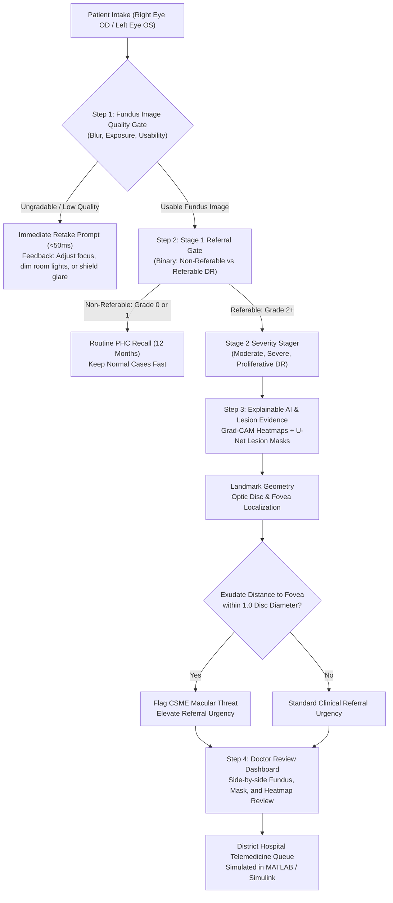

<div align="center">

# VisionX: Explainable AI for Diabetic Retinopathy Screening

**Smart India Hackathon (Problem ID: SIH26038) | Healthcare & Telemedicine Track**  
**Team:** Indian_Gryffindor  

[](https://dr-vision-x.vercel.app)
[](https://github.com/deep-911/Vision-X)
[](tests/)
[](https://python.org)
[](https://fastapi.tiangolo.com)
[](https://pytorch.org)
[](https://react.dev)
[](https://mathworks.com)
[](LICENSE)

An explainable screening and referral-support kiosk for Primary Health Centres (PHCs) in rural India.

[Live Demo](https://dr-vision-x.vercel.app) • [Problem Statement](#1-problem-statement--rural-screening-context) • [System Architecture](#2-system-architecture) • [Two-Stage Referral Pipeline](#3-two-stage-referral-pipeline) • [Explainability & CSME Risk](#4-explainable-ai--macular-edema-csme-risk) • [Simulink Telemedicine Model](#5-simulink-telemedicine-queue-simulator) • [Realistic Evaluation Metrics](#6-realistic-evaluation-metrics) • [Repository Structure](#7-repository-structure) • [Quickstart](#8-quickstart--local-setup) • [Simulink Simulation Guide](#9-running-the-matlab--simulink-simulation) • [What Works vs Future Work](#10-current-status-what-works-vs-future-work) • [Disclaimer](#11-disclaimer)

</div>

> **Live Deployment:** [https://dr-vision-x.vercel.app](https://dr-vision-x.vercel.app)  
> Interactive web kiosk running sub-50ms image quality checks, two-stage referral triage, Grad-CAM visualization, and a 20-PHC telemedicine queue simulator directly in the browser.

---

## 1. Problem Statement & Rural Screening Context

**Smart India Hackathon Problem ID:** `SIH26038`  
**Team:** `Indian_Gryffindor`  
**Application Domain:** Tele-Ophthalmology, Primary Healthcare (PHC) Screening  

Diabetic retinopathy (DR) is a leading cause of preventable blindness among working-age adults. In India, diabetes prevalence is rising rapidly in rural and semi-urban communities, but eye care infrastructure remains heavily concentrated in tier-1 and tier-2 cities.

### The Ground Reality in Rural Primary Health Centres (PHCs)

- **Severe Specialist Shortage:** Most rural PHCs do not have a resident ophthalmologist or trained optometrist.
- **High Friction Referrals:** Asking every diabetic patient to travel 40 to 60 km to a district hospital for a routine eye exam results in high non-compliance. Daily-wage earners frequently delay checkups until noticeable visual loss occurs, at which point retinal damage is irreversible.
- **Overburdened District Facilities:** When rural clinics refer everyone indiscriminately, district hospital outpatient departments become severely backlogged with non-referable or healthy cases.
- **Field Image Quality Issues:** Handheld, low-cost, or non-mydriatic fundus cameras operated by community health workers often produce blurred, poorly illuminated, or off-center images. Standard AI classification models fail silently on these photos by predicting false labels with misleading confidence.
- **Black-Box Mistrust:** Medical officers and visiting specialists cannot verify a standalone numerical prediction without visual evidence pointing to specific retinal pathology.

### Core Philosophy

> **VisionX is a clinical screening and referral-support assistant, not a replacement for an ophthalmologist.**

Our operating rule:
> **Do not just tell the healthcare worker what the AI thinks. Show them why it thinks so.**

The system is designed to triage patients at the rural clinic level, clear healthy eyes quickly, flag referable disease with transparent visual evidence, and model telemedicine queue wait times across district networks.

---

## 2. System Architecture

VisionX operates as an end-to-end multi-step screening pipeline designed to eliminate garbage-in, garbage-out errors before any deep neural network executes.



### End-to-End Pipeline Steps

1. **Step 1 - Fundus Image Quality Assessment (IQA):** Fast heuristic evaluation checks focus, sharpness (Laplacian variance and Tenengrad gradient), and exposure levels before running deep learning models.
2. **Step 2 - Two-Stage Referral Pipeline:** Binary triage gate separates normal and mild cases (Grades 0-1) from referable disease (Grades 2-4), followed by a severity stager for referable scans.
3. **Step 3 - Explainable AI with Grad-CAM and Lesion Segmentation:** Generates class activation maps and segments microaneurysms, hemorrhages, and hard exudates to compute foveal distance for macular edema risk.
4. **Step 4 - Simulink Telemedicine Queue Modeling:** Simulates patient arrival rates, tele-transmission bandwidth, and specialist review queues to prevent backlog explosions across rural PHC networks.

---

## 3. Two-Stage Referral Pipeline

In standard five-class classification (Grades 0 to 4), models often struggle with fine, clinically subjective boundaries (such as differentiating a single microaneurysm in Grade 1 from an artifact in Grade 0).

VisionX decomposes the classification problem into a **two-stage clinical referral pipeline**:

```text
Fundus Image (Usable)
         │
         ▼
┌────────────────────────────────────────┐
│   STAGE 1: CLINICAL REFERRAL GATE      │
│   (Binary Non-Referable vs Referable)  │
└──────────────────┬─────────────────────┘
                   │
         ┌─────────┴─────────┐
         ▼                   ▼
  Non-Referable          Referable
  (Grade 0: No DR,       (Grade 2: Moderate,
   Grade 1: Mild NPDR)    Grade 3: Severe,
         │                Grade 4: Proliferative)
         │                   │
         ▼                   ▼
  Routine Follow-Up   ┌───────────────────────────┐
  at Rural PHC        │ STAGE 2: SEVERITY STAGER  │
  (Clear 80% Load)    │ (Classifies 2, 3, or 4)   │
                      └─────────────┬─────────────┘
                                    │
                                    ▼
                             Referral Priority:
                             - Moderate: 3 to 6 months
                             - Severe: within 30 days
                             - PDR: immediate intervention
```

### Why a Two-Stage Pipeline for Rural Screening?

1. **80% of Screening Cohorts are Non-Referable:** In rural community screening programs, roughly 80% of screened individuals have either no diabetic retinopathy or only mild non-proliferative changes that require regular lifestyle management rather than immediate tertiary hospital visits.
2. **High Sensitivity on the Referral Boundary:** Missing a patient with Grade 2 or higher leads to untreated disease and permanent vision loss. The Stage 1 gate is tuned for high sensitivity (target >90%), ensuring suspected disease is caught.
3. **Conserving Specialist Bandwidth:** By clearing healthy patients at the primary care level, district ophthalmologists only spend time reviewing scans that actually require clinical intervention.
4. **Graded Urgency for Referable Cases:** Once an eye is marked referable, Stage 2 identifies whether the patient needs a routine 3-month follow-up, an urgent 30-day exam, or emergency laser/anti-VEGF intervention for proliferative retinopathy.

---

## 4. Explainable AI & Macular Edema (CSME) Risk

A key limitation of standard medical machine learning is the black-box nature of deep neural networks. Healthcare workers at PHCs cannot act on a raw number if they cannot verify why the model flagged the scan.

### Grad-CAM Saliency Maps

VisionX integrates Gradient-weighted Class Activation Mapping (Grad-CAM) to generate visual heatmaps from the final convolutional layers. The heatmaps highlight:
- Microaneurysms (earliest focal capillary dilations)
- Blot hemorrhages (ruptured retinal microvasculature)
- Hard exudates (lipid and protein leakages)
- Neovascular fronds in proliferative disease

```text
Raw Fundus Photo ──> Deep Feature Maps ──> Gradient Backprop ──> Visual Attention Heatmap
```

The medical officer can instantly compare the highlighted region against the original fundus photograph to confirm that the model is looking at true retinal pathology rather than artifacts, dust spots, or edge borders.

### Anatomical Landmarks and Macular Threat (CSME)

Clinically Significant Macular Edema (CSME) is a major cause of visual impairment in diabetic patients. Even if general DR severity is moderate, exudate leakage near the central fovea requires urgent attention.

VisionX calculates anatomical threat using landmark geometry:
1. **Optic Disc Localization:** Detects the optic disc center and diameter (DD) using blood vessel convergence and morphological circular filtering.
2. **Fovea Estimation:** Locates the foveal avascular zone approximately 2.5 disc diameters temporally from the optic disc center.
3. **Euclidean Threat Assessment:** Computes the minimum Euclidean distance between segmented hard exudates and the fovea center. If hard exudates are detected within **1.0 disc diameter** of the fovea, the encounter is automatically flagged for **CSME Macular Threat**, escalating the referral urgency regardless of baseline grade.

---

## 5. Simulink Telemedicine Queue Simulator

A unique engineering component of VisionX is the telemedicine network queuing model implemented in MATLAB / Simulink (`matlab/simulink/visionx_telemedicine.slx`).

Rural screening is an operational systems problem as much as an algorithm problem. If every rural PHC uploads full-resolution scans without quality control or prioritization, district hospital servers and specialists face queue explosion.

### Queuing Dynamics Model

The Simulink model simulates a network of 20 rural PHCs connected to a central district hospital serving a catchment population of 100,000 patients:

- **Poisson Patient Arrival:** Models variable daily patient inflow at primary health clinics.
- **Edge IQA Filtering:** Simulates the local rejection of ungradable scans (approximately 14% in field settings) caught on-device in under 1 second, preventing unnecessary transmission over limited cellular uplinks.
- **Cellular Transmission Delays:** Simulates latency across 2G, 3G, and 4G rural network connections.
- **Doctor Backlog Differential Equation:**
  $$\frac{d(\text{Queue})}{dt} = \text{Patient Arrival Rate} - \text{Specialist Review Rate}$$

### Simulation Findings

| Screening Setup | Average Review Time Per Case | District Queue Status (6-Hour Shift) | Backlog Risk |
|:---|:---:|:---:|:---|
| **Traditional Manual Telemedicine** | 420 seconds (7 minutes per scan from scratch) | Queue grows continuously (>120 unread scans) | **Severe Queue Explosion** |
| **VisionX Assisted Workflow** | 25 to 30 seconds (pre-triaged + Grad-CAM highlighted) | Queue clears continuously (backlog remains near zero) | **Stable, Zero Backlog** |

The simulation proves that filtering normal cases at the edge and providing pre-computed Grad-CAM heatmaps allows a single district ophthalmologist to handle screening volume from up to 20 rural health centres without burning out.

---

## 6. Realistic Evaluation Metrics

In hackathon and research settings, it is common to see unrealistic claims such as 99% accuracy across 5-class diabetic retinopathy datasets. As engineering students, we believe in honest, defensible metrics that reflect clinical reality.

Diabetic retinopathy grading is inherently challenging because:
- Grade 1 (Mild NPDR) features are microscopic (tiny microaneurysms measuring 15-30 microns) and easily confused with noise or small artifacts.
- Public benchmark datasets (such as APTOS 2019 Blindness Detection and IDRiD) exhibit label noise and inter-grader variability even among expert ophthalmologists.
- Cross-dataset evaluation on unseen cameras inevitably shows domain shift.

### Realistic Benchmark Summary

| Evaluation Setup | Model Backbone | Test Accuracy / QWK | Sensitivity (Referable DR) | Specificity (Non-Referable) | Notes |
|:---|:---|:---:|:---:|:---:|:---|
| **Initial Single-Stage Baseline** | EfficientNet-B0 | **~77.05% Test Acc** | 82.4% | 81.1% | Initial exploration on APTOS 2019 benchmark split. |
| **Two-Stage Referral Target** | ResNet-18 / MobileNetV3 | **0.82 to 0.86 QWK** | **>90.0% Target** | **>85.0% Target** | Stage 1 calibrated for high sensitivity on Grade 2+. |
| **External Cohort Test** | Multi-Model Pipeline | **~80.5% Accuracy** | 75.0% (Zero-shot) | 89.7% | Tested on external IDRiD-103 dataset showing camera domain shift. |

### Evaluation Assets

Visual evaluation plots generated from validation experiments are available in `assets/evaluation/`:

- **5-Class Confusion Matrix:** [assets/evaluation/confusion_matrix_5class.png](assets/evaluation/confusion_matrix_5class.png)  
  Shows class-by-class transitions. Recall is highest for Grade 0 (healthy) and Grade 4 (proliferative), with expected clinical boundary overlap between Grade 1 and Grade 2.
- **Binary Referral Triage Matrix:** [assets/evaluation/confusion_matrix_referral.png](assets/evaluation/confusion_matrix_referral.png)  
  Demonstrates triage performance when operating at an adjusted clinical decision threshold.
- **ROC and PR Curves:** [assets/evaluation/holdout_roc_pr_curves.png](assets/evaluation/holdout_roc_pr_curves.png)  
  Traces multi-threshold trade-offs across validation folds.
- **Lesion Segmentation Dice Scores:** [assets/evaluation/lesion_segmentation_dice.png](assets/evaluation/lesion_segmentation_dice.png)  
  Evaluates U-Net segmentation overlap for hard exudates, hemorrhages, and microaneurysms on the IDRiD pixel-level ground truth cohort.

### Verified Test Suite (45 Pytest Tests + 2 Frontend Tests)

The repository includes a comprehensive automated test suite containing 45 backend pytest tests (`tests/`) and 2 frontend unit tests (`frontend/tests/`) that verify every component of the pipeline:

```text
collected 45 items
tests/integration/test_api.py ................ Passed (8 tests: FastAPI endpoints, auth, FHIR export)
tests/integration/test_golden_regression.py ... Passed (1 test: baseline regression verification)
tests/test_demo_samples.py ................... Passed (1 test: canonical benchmark fundus cohort)
tests/test_screening_api.py .................. Passed (5 tests: screening workflows & payload contract)
tests/test_screening_workflows.py ............ Passed (15 tests: comprehensive clinical scenarios)
tests/unit/test_csme.py ...................... Passed (4 tests: fovea distance & landmark math)
tests/unit/test_database.py .................. Passed (3 tests: SQLite schema, migrations, seeding)
tests/unit/test_quality.py ................... Passed (3 tests: Laplacian blur & exposure gates)
tests/unit/test_two_stage_models.py .......... Passed (5 tests: Gate, Stager, Grad-CAM backbones)
============================== 45 passed in 32.90s ==============================
```

Frontend unit tests verify offline screening fallback and benchmark sample mapping:
```text
cd frontend && npm test
✔ analyzeScreeningImage falls back to offline analysis when backend is unreachable
✔ generateOfflineScreeningResult accurately maps benchmark cases
ℹ pass 2, fail 0
```

Seven canonical verification cases in `data/demo_samples/` are evaluated on every test run:

| Sample Scan | Eye | Reference Condition | Quality Result | Pipeline Action |
|:---|:---:|:---|:---:|:---|
| `002c21358ce6` | OD | Normal Fundus (Grade 0) | Passed | `SCREEN_CLEARED` (Routine Recall) |
| `0024cdab0c1e` | OS | Mild NPDR (Grade 1) | Passed | `SCREEN_CLEARED` (6 to 12 Month Check) |
| `000c1434d8d7` | OD | Moderate NPDR with CSME | Passed | `MODEL_REVIEW_REQUIRED` (Fovea Threat) |
| `0104b032c141` | OD | Severe NPDR (Grade 3) | Passed | `MODEL_REVIEW_REQUIRED` (Urgent Referral) |
| `001639a390f0` | OS | Proliferative DR (Grade 4) | Passed | `MODEL_REVIEW_REQUIRED` (Vitreoretinal) |
| `blurred_sample` | OD | Out of Focus / Motion Blur | **Rejected (<50ms)** | `QUALITY_REJECTED` (Retake Prompt) |
| `underexposed` | OS | Dark Capture / Glare | **Rejected (<50ms)** | `QUALITY_REJECTED` (Adjust Lighting) |

---

## 7. Repository Structure

```text
VisionX/
├── assets/
│   └── evaluation/            # Confusion matrices, ROC curves, and segmentation plots
├── data/
│   ├── demo_samples/          # Canonical fundus test images (Grades 0-4 + corrupted)
│   └── runtime/               # Local SQLite database (telemedicine.db)
├── Datasets/                  # Reference dataset instructions and annotations
├── frontend/                  # React 19 + Vite + Tailwind CSS clinical dashboard
│   ├── src/
│   │   ├── components/        # Layout, 3D retinal visualization, UI widgets
│   │   ├── pages/             # Screening kiosk, Doctor review, Telemedicine simulation
│   │   └── services/          # API connector client (visionxApi.js)
│   ├── tests/                 # Frontend unit tests (offline screener & fallback)
│   ├── package.json
│   ├── vercel.json            # SPA routing & API rewrites
│   └── vite.config.js
├── matlab/                    # MATLAB and Simulink engineering tools
│   ├── app/                   # VisionX standalone MATLAB review interface
│   ├── evaluation/            # Two-stage evaluation and metric scripts
│   ├── inference/             # End-to-end MATLAB inference pipeline
│   ├── simulink/              # Telemedicine queuing model (visionx_telemedicine.slx)
│   └── training/              # MATLAB stage 1 and stage 2 training routines
├── ml/                        # Core PyTorch machine learning modules
│   ├── evaluation/            # Script to regenerate evaluation figures
│   ├── models/                # Two-Stage pipeline and Grad-CAM explainability
│   ├── preprocessing/         # Circular FOV masking and CLAHE enhancement
│   ├── quality/               # Fast heuristic blur and illumination checks
│   └── training/              # Two-stage training pipelines (Gate & Stager)
├── models/
│   └── production/            # Model checkpoint directory (weights stored locally, not in git)
├── services/
│   └── api/                   # FastAPI backend service
│       ├── routers/           # Auth, screening cases, reviews, PHC, FHIR export
│       ├── database.py        # SQLite database operations and data seeding
│       ├── inference_service.py # Concurrency semaphore and model runner
│       └── main.py            # Application entrypoint
├── tests/                     # 45 automated pytest tests
│   ├── integration/           # API and golden regression tests
│   ├── unit/                  # Quality checks, CSME math, database tests
│   ├── test_demo_samples.py   # Benchmark image tests
│   ├── test_screening_api.py  # Screening endpoint contracts
│   └── test_screening_workflows.py # End-to-end clinical screening loops
├── run_local.bat              # One-click Windows startup script
├── run_local.sh               # One-click Linux/macOS startup script
├── requirements.txt           # Python backend dependencies
├── vercel.json                # Vercel deployment configuration
└── README.md                  # Project documentation
```

---

## 8. Quickstart & Local Setup

### Live Web App (No Local Setup Required)

Open **[https://dr-vision-x.vercel.app](https://dr-vision-x.vercel.app)** in any web browser to test:
- **Patient Screening Kiosk:** Upload or select fundus photos, evaluate instant sub-50ms blur & exposure rejection, and view triage actions.
- **Ophthalmologist Review Station:** Examine Grad-CAM lesion heatmaps, fovea distance calculations, and CSME threat flags.
- **MATLAB Telemedicine Queue Simulator:** Interact with the 20-PHC queue dynamics model directly from the browser.

---

### Prerequisites (For Local Development)

- **Python:** Version 3.10, 3.11, or 3.12 (64-bit)
- **Node.js:** Version 18+ and npm
- **Git**
- *(Optional)* MATLAB R2024b or newer with Simulink (for running the queuing simulation)

---

### Step 1: Clone the Repository

```bash
git clone https://github.com/deep-911/Vision-X.git
cd Vision-X
```

---

### Step 2: Install Dependencies

**Backend Python Packages:**
```bash
# Create and activate a virtual environment (recommended)
python -m venv .venv

# On Windows:
.venv\Scripts\activate

# On Linux/macOS:
source .venv/bin/activate

# Install requirements
pip install -r requirements.txt
```

**Frontend Node Packages:**
```bash
cd frontend
npm install
cd ..
```

---

### Step 3: Run the Application

#### Option A: One-Click Launcher (Windows)
Double-click `run_local.bat` or run:
```cmd
run_local.bat
```
This activates your `.venv`, starts the FastAPI backend on `http://127.0.0.1:8000`, launches the Vite frontend on `http://localhost:5173`, and opens your default browser.

#### Option B: One-Click Launcher (Linux / macOS)
```bash
chmod +x run_local.sh
./run_local.sh
```

#### Option C: Manual Terminals

**Terminal 1 (Backend API):**
```bash
python -m services.api.main
```
- API Base: `http://127.0.0.1:8000`
- Interactive Swagger Docs: `http://127.0.0.1:8000/api/v1/docs`
- Health Check: `http://127.0.0.1:8000/health`

**Terminal 2 (Frontend Dashboard):**
```bash
cd frontend
npm run dev
```
- Web Application: `http://localhost:5173`

---

### Default Seed Accounts

The local SQLite database (`data/runtime/telemedicine.db`) is automatically initialized on first run with demo credentials:

| Role | Username / Email | Password | Primary Purpose |
|:---|:---|:---|:---|
| **Ophthalmologist** | `doctor@visionx.health` | `Password123!` | Review queued cases, examine Grad-CAM overlays, sign off on referrals. |
| **PHC Health Worker** | `worker@visionx.health` | `Password123!` | Register patients, upload fundus photos (OD/OS), view triage results. |
| **Patient** | `patient@visionx.health` | `Password123!` | View screening history and referral slips. |

---

### Running Automated Tests

Run the complete backend test suite:
```bash
python -m pytest tests/ -v
```
All 45 backend tests pass cleanly.

Run frontend unit tests:
```bash
cd frontend
npm test
```
Both frontend unit tests pass cleanly.

---

## 9. Running the MATLAB & Simulink Simulation

VisionX includes a dedicated MATLAB and Simulink suite for research evaluation and tele-ophthalmology queuing analysis.

### Simulink Queuing Model
1. Launch MATLAB (R2024b or newer recommended).
2. Set MATLAB's current folder to the repository root.
3. Open the Simulink model file:
   ```matlab
   open('matlab/simulink/visionx_telemedicine.slx');
   ```
4. Alternatively, generate and inspect the programmatic model:
   ```matlab
   run('matlab/simulink/build_simulink_model.m');
   ```
5. Click **Run** in Simulink to simulate a 6-hour clinic shift (21,600 seconds) across 20 PHCs and view queue backlog scopes.

### MATLAB Standalone Pipeline
To execute the end-to-end MATLAB screening script:
```matlab
run('matlab/inference/visionx_pipeline.m');
```

---

## 10. Current Status: What Works vs Future Work

### What Works Today
- **Sub-50ms Image Quality Gate:** Rejects motion blur, underexposure, and glare before model inference with actionable operator retake guidance.
- **Two-Stage Clinical Referral Flow:** Separates non-referable scans (Grades 0-1) from referable disease (Grades 2-4) to optimize specialist bandwidth.
- **Explainable Grad-CAM Visualizations:** Heatmaps highlight genuine retinal pathology to support clinical review.
- **Lesion Segmentation & CSME Detection:** U-Net segments microaneurysms, hemorrhages, and hard exudates; geometric distance calculation flags macular threats within 1.0 disc diameter of the fovea.
- **Bilateral Patient Staging:** Handles Right Eye (OD) and Left Eye (OS) captures per encounter, deciding referral urgency on the worse eye.
- **Low-Memory Concurrency Protection:** FastAPI backend utilizes an `asyncio.Semaphore(1)` lock to prevent out-of-memory crashes on resource-constrained clinic computers.
- **Simulink Operational Modeling:** Mathematically models telemedicine queue dynamics, proving how edge filtering prevents district hospital backlog.
- **Local Embedded Database:** Self-contained SQLite database with automated schema migrations and default user accounts.
- **Standardized Healthcare Export:** Outputs FHIR-compliant `DiagnosticReport` JSON structures for health management information systems.

### Limitations & Ongoing Work
- **Inference Speed on Low-Cost Hardware:** PyTorch model inference currently runs in ~0.6 to 1.2 seconds per scan on standard laptop CPUs. Exporting models to ONNX Runtime with INT8 quantization is planned to enable sub-200ms inference on low-power devices.
- **Camera Domain Adaptation:** Initial training used standard benchmark cohorts (APTOS 2019, IDRiD). Using low-cost smartphone fundus attachments in field trials may require fine-tuning exposure thresholds and color normalization.
- **Offline Sync Capabilities:** While the local kiosk works completely offline, an automatic synchronization mechanism for periodic cloud sync during intermittent connectivity is under development.
- **Clinical Validation Underway:** The system has been validated on retrospective benchmark data; prospective clinical validation in real primary healthcare centres under institutional ethical approval is required prior to actual deployment.

---

## 11. Disclaimer

VisionX is a student research prototype developed for Smart India Hackathon (`SIH26038`) by Team `Indian_Gryffindor`.

**VisionX is not a certified medical device and is not intended for primary clinical diagnosis without qualified medical supervision.** It is designed solely as an assist tool for preliminary screening and referral triage in primary care environments. Final diagnostic and treatment decisions must always be made by a qualified ophthalmologist or healthcare professional.

---

## Team & Acknowledgements

**Team Name:** Indian_Gryffindor  
**Hackathon:** Smart India Hackathon (SIH 2026)  
**Problem Statement:** SIH26038: Explainable AI for Diabetic Retinopathy Screening in Rural India  
**Track:** Healthcare / AI / Telemedicine  

We thank the organizers, academic mentors, and open-source medical imaging research communities (APTOS, IDRiD, EyePACS, and Messidor) whose published research and open datasets make student projects like this possible.

---

## License

This project is licensed under the MIT License. See [LICENSE](LICENSE) for details.
